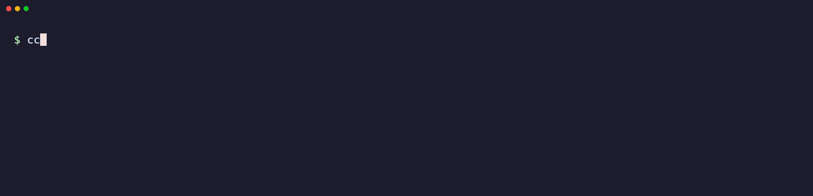
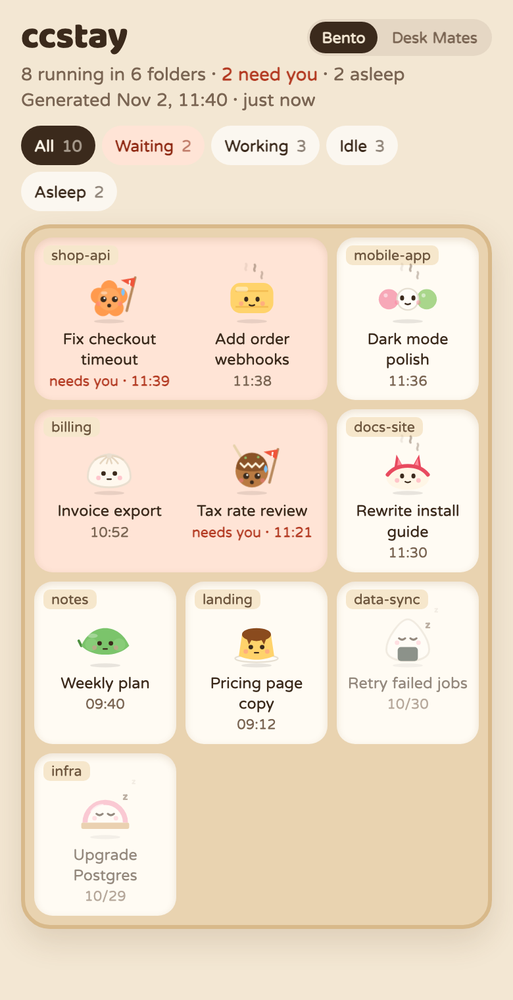
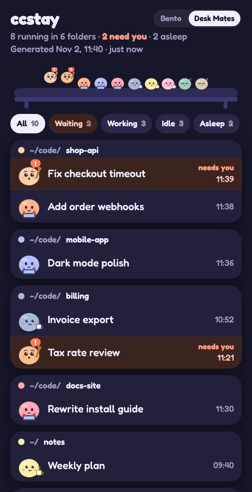

# ccstay: never lose a Claude Code session

**ccstay is a session manager for [Claude Code](https://claude.com/claude-code). It keeps sessions running after you close a terminal tab, restores them after you restart your Mac, puts idle ones to sleep to free memory, and finds closed ones so you can reopen them, even from your phone.**

[繁體中文](README.zh-TW.md)



<p>
  
  
</p>

## Why ccstay

If you run many Claude Code sessions at once, you know these problems:

| Problem | What ccstay does |
|---|---|
| You close a terminal tab and the Claude Code session ends with it | The session keeps running on a private tmux server. You never see tmux: no status bar, no prefix key, and your own tmux setup is left alone. |
| You restart your Mac and lose track of what was open, and in which folder | `ccstay restore` brings back what was running, in the same windows and tab order. Asleep sessions stay asleep. |
| A dozen idle sessions hold memory | Sleep turns a session of 100 MB or more into an idle shell of about 3 MB. The tab stays; press Enter to resume the same conversation. Sessions idle for 24 hours sleep on their own. |
| You closed a session and can't find it again | Every session keeps a record. `ccstay closed <text>` searches by title or folder and `ccstay reopen` brings it back. |
| You are away from your computer | Do all of this from the Claude app through Remote Control. |

No daemon. Needs only Python and tmux.

| | iTerm + tmux | Ghostty + tmux | iTerm, no tmux |
|---|---|---|---|
| `ccstay new <folder>` plus | nothing | `-t ghostty` | `--no-tmux` |
| Keeps running after you close the tab | ✅ | ✅ | ❌ |
| Listed in `ccstay ls` | ✅ | ✅ | ✅ |
| Sleep, wake, press Enter to resume | ✅ | ✅ | ✅ |
| Auto-sleep when idle | ✅ | ✅ | ❌ |
| Restart in place after an update | ✅ | ✅ | ✅ |
| Restore after a reboot | ✅ | ✅ | ✅ |
| Show it again with `attach` or `open` | ✅ | ✅ | ❌ |
| Find and reopen closed sessions | ✅ | ✅ | ✅ |
| All of it from your phone with Remote Control | ✅ | ✅ | ✅ |

`ccstay ls` also finds Claude Code sessions already running in iTerm tabs.

| You want to | Run |
|---|---|
| Start a session | `ccstay new <folder> [name]` |
| See everything | `ccstay ls` |
| Show a session here, or in a new tab | `ccstay attach <name>`, `ccstay open <name>` |
| Free a session's memory, keep its tab | `ccstay sleep <name>`; press Enter or `ccstay wake <name>` |
| Update Claude Code, restart idle sessions in place | `ccstay reload`, then `ccstay reload -y` |
| Bring everything back after a reboot | `ccstay restore [--tabs]` |
| End a session on purpose | `ccstay close <name>` |
| Find sessions that ended | `ccstay closed [text]` |
| Reopen one | `ccstay reopen <name or id>` |
| Overview of projects | `ccstay board [days]` |
| Phone-friendly list of sessions | `ccstay folders` |

## Install

For macOS, with [Homebrew](https://brew.sh) and [Claude Code](https://claude.com/claude-code) signed in:

```sh
brew install ttcat/tap/ccstay
ccstay setup
```

`ccstay setup` asks first, including which terminal to use if you have both iTerm and Ghostty, then starts a timer that records state and auto-sleeps idle sessions every minute, adds two Claude Code hooks that notice `/exit` at once, and checks that everything works.

From now on:

- Start sessions with `ccstay new <folder>` instead of `claude`.
- After a reboot, run `ccstay restore --tabs`.

The first tab opened in each terminal triggers a macOS Automation permission prompt. Click OK.

ccstay needs Python 3.9+ and tmux 3.2+. Opening tabs needs macOS with iTerm2 or Ghostty 1.4+; anywhere else sessions run detached and you use `ccstay attach`. Without Homebrew, clone this repo and run `./install.sh`, or use `uv tool install .` or `pipx install .`.

## From your phone

You never have to go back to your computer. Open any session in the Claude app through Remote Control and ask:

- "What did I close yesterday?" Claude runs `ccstay closed`.
- "Reopen the checkout session." Claude runs `ccstay reopen`.
- "Put the idle ones to sleep." Claude runs `ccstay sleep`.

`ccstay folders` writes a page of running sessions grouped by folder, plus recently closed ones. Tap a running session to open it. The page comes in two looks, Bento and Desk Mates, switched at the top and remembered on that phone; `ccstay folders --theme mates` starts with the other one, `ccstay themes` lists them, and [themes/README.md](themes/README.md) explains how to add your own. It reads in English or Traditional Chinese, following the phone's language.

## Close the tab, or sleep?

| | Tab closed | Asleep |
|---|---|---|
| Claude keeps running | Yes | No |
| Memory | Unchanged, 100 MB or more | About 3 MB |
| Tab stays open | No | Yes |
| Come back with | `ccstay attach` or `ccstay open` | Enter in the tab, or `ccstay wake` |

Closing a tab frees almost nothing, because Claude keeps running in tmux. To free memory and keep the tab, use sleep.

Sessions sleep by themselves after 24 idle hours. To make it two days:

```sh
export CCSTAY_IDLE_HOURS=48    # add this to ~/.zshrc
ccstay timer on
```

## Light by design

- **No daemon.** A timer runs `ccstay tick` and exits: launchd on macOS, systemd on Linux.
- **One tmux server** for all sessions, about 3 MB.
- **Sleeping costs almost nothing.** A running session holds 100 MB or more; asleep it is one idle `/bin/sh` of about 3 MB. Sessions idle for 24 hours sleep on their own.
- **Restores are staggered** and only start what was awake.

## What is remembered

Every session keeps a record for good. Nothing is dropped when a session ends.

| State | Meaning | After a reboot |
|---|---|---|
| `open` | Running | Nothing to do |
| `suspect` | Just vanished, checked again a minute later | Nothing to do |
| `closed` | You ended it | Stays closed; use `ccstay reopen` |
| `interrupted` | A reboot, a crash or quitting iTerm took it down | `ccstay restore` brings it back |
| `gone` | Claude Code has deleted the conversation (see `cleanupPeriodDays`) | Listed only |

Shutdown ends sessions without notice, so ccstay judges afterwards: a session counts as closed only if the machine and its terminal are still the same a check later. A wrong guess only moves it to the other list.

`ccstay hooks on` is optional: it adds two hooks to Claude Code's `settings.json` so `/exit` counts as closed at once, and `ccstay hooks off` removes them. Everything works without them, a check later.

Window and tab positions are recorded every minute, and `restore` uses them to put tabs back in their windows.

## Settings

| Variable | Default | Meaning |
|---|---|---|
| `CCSTAY_IDLE_HOURS` | `24` | Auto-sleep after this many idle hours, `0` turns it off |
| `CCSTAY_TERMINAL` | detected | `iterm`, `ghostty` or `none` |
| `CCSTAY_REMOTE` | unset | `1` forces Remote Control on; otherwise Claude Code's own setting decides |
| `CCSTAY_SOCKET` | `ccstay` | tmux socket name |

The timer does not read your shell setup, so after changing one of these, run `ccstay timer on` again to carry it over.

Add your own tmux settings in `$XDG_CONFIG_HOME/ccstay/tmux.conf`, by default `~/.config/ccstay/tmux.conf`.

`ccstay keep <name>` exempts a session from auto-sleep. Sessions that are working, waiting for you, or have no messages yet are never put to sleep.

## What ccstay touches

Nothing outside its own state folder changes unless you ask. It makes no network calls of its own; `ccstay reload -y` runs Claude Code's own updater.

| Place | When | Undo |
|---|---|---|
| `~/.local/bin/ccstay` | `./install.sh` | `ccstay uninstall` |
| `~/.local/state/ccstay/` | Always, for records and tmux config | `ccstay uninstall --purge` |
| `~/Library/LaunchAgents/dev.ccstay.tick.plist` or a systemd user timer | `ccstay timer on` | `ccstay timer off` |
| `~/.claude/settings.json`, backed up once beside it | `ccstay hooks on` | `ccstay hooks off` |

Claude Code's own background sessions stop when idle and do not stay in your terminal tabs. ccstay manages ordinary interactive sessions and keeps your tabs, sleep and reboot restore under your control.

## Uninstall

```sh
ccstay uninstall           # removes the timer, hooks and link
ccstay uninstall --purge   # also deletes ccstay's records, once no sessions run under it
```

Conversations stay in Claude Code. If you used uv or pipx, then run `uv tool uninstall ccstay` or `pipx uninstall ccstay`.

## FAQ

**How do I keep a Claude Code session running after closing the terminal?**
Start it with `ccstay new <folder>`. It runs in tmux, so closing the tab does not end it. Show it again with `ccstay attach <name>` or `ccstay open <name>`.

**How do I restore Claude Code sessions after a restart?**
Run `ccstay restore --tabs`. It reopens what was running in the same order, as long as the timer from `ccstay setup` was on.

**How do I reduce Claude Code memory use with many sessions?**
Run `ccstay sleep <name>`, or let idle sessions sleep on their own. A session of 100 MB or more drops to about 3 MB and resumes with Enter.

**How do I find a Claude Code session I closed?**
Run `ccstay closed <text>` to search by title or folder, then `ccstay reopen <name or id>`.

**Can I manage Claude Code sessions from my phone?**
Yes. Open a session in the Claude app through Remote Control and ask Claude to run any `ccstay` command.

**Does closing a tab free memory?**
No. Claude keeps running in tmux. Use sleep to free memory.

**Which terminals work?**
iTerm2 and Ghostty 1.4+ on macOS. Elsewhere sessions run detached and you use `ccstay attach`.

## Contributing

See [CONTRIBUTING.md](CONTRIBUTING.md), [SECURITY.md](SECURITY.md) and [CHANGELOG.md](CHANGELOG.md).

## Development

```sh
python3 -m unittest discover -s tests
```

Tests drive a real tmux with a fake claude and need no account.

MIT License.
