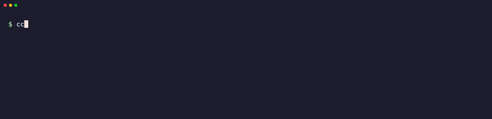

# ccstay

**不再弄丟 Claude Code session。** 關掉分頁、重開機，或放著不管，它都留著，之後也找得回來。

[English](README.md)



- **關分頁不會結束：** session 跑在獨立的 tmux 裡。你看不到 tmux：沒有狀態列、沒有前綴鍵，也不影響你自己的 tmux 設定。
- **閒置會休眠：** 執行中的 session 佔 100 MB 以上，休眠後只剩約 3 MB 的閒置 shell，分頁還在，按 Enter 接回同一段對話。
- **重開機撐得過：** `ccstay restore` 把原本在跑的帶回來，休眠的維持休眠，並照原本的視窗和分頁順序開。
- **關掉不等於不見：** 每個 session 都有紀錄，之後可以搜尋並重新打開。
- **手機也能用：** session 可透過 Remote Control 接上，`ccstay folders` 會產生連到每個 session 的頁面。

不常駐，只有一個 Python 檔，沒有外部相依。

| | iTerm + tmux | Ghostty + tmux | iTerm 不用 tmux |
|---|---|---|---|
| `ccstay new <資料夾>` 再加 | 不用加 | `-t ghostty` | `--no-tmux` |
| 關分頁後繼續跑 | ✅ | ✅ | ❌ |
| 列在 `ccstay ls` | ✅ | ✅ | ✅ |
| 休眠、喚醒、按 Enter 接回 | ✅ | ✅ | ✅ |
| 閒置自動休眠 | ✅ | ✅ | ❌ |
| 更新後原地重啟 | ✅ | ✅ | ✅ |
| 重開機還原 | ✅ | ✅ | ✅ |
| 用 `attach` 或 `open` 重新顯示 | ✅ | ✅ | ❌ |
| 找回並重開已關閉的 session | ✅ | ✅ | ✅ |
| 以上都能用手機透過 Remote Control 完成 | ✅ | ✅ | ✅ |

`ccstay ls` 也會找到已經在 iTerm 分頁裡跑的 Claude Code session。

| 想做的事 | 指令 |
|---|---|
| 開新 session | `ccstay new <資料夾> [名稱]` |
| 看全部 session | `ccstay ls` |
| 在這裡或新分頁顯示 session | `ccstay attach <名稱>`、`ccstay open <名稱>` |
| 釋放記憶體但留著分頁 | `ccstay sleep <名稱>`；按 Enter 或 `ccstay wake <名稱>` 接回 |
| 更新 Claude Code，閒置的 session 原地重啟 | `ccstay reload`，確認後 `ccstay reload -y` |
| 重開機後全部還原 | `ccstay restore [--tabs]` |
| 主動結束 session | `ccstay close <名稱>` |
| 找已結束的 session | `ccstay closed [文字]` |
| 重新打開 | `ccstay reopen <名稱或編號>` |
| 專案總覽 | `ccstay board [天數]` |
| 手機用的 session 清單 | `ccstay folders` |

## 安裝

以下是 macOS 的步驟。需要先裝好 [Homebrew](https://brew.sh) 和 [Claude Code](https://claude.com/claude-code)，並登入 Claude Code。

```sh
brew install tmux python git
git clone https://github.com/ttcat/ccstay && cd ccstay
./install.sh
```

如果畫面要你把 `~/.local/bin` 加進 PATH，執行下面這行，再開新的終端機：

```sh
echo 'export PATH="$HOME/.local/bin:$PATH"' >> ~/.zshrc
```

接著開啟功能：

```sh
ccstay setup
```

它會開啟每分鐘記錄狀態、自動休眠閒置 session 的排程，加入兩個立刻察覺 `/exit` 的 Claude Code hook，再檢查是否都正常。動手前會先詢問。之後這樣用：

- 開 session 時，用 `ccstay new <資料夾>` 取代 `claude`。
- 重開機後，執行 `ccstay restore --tabs`。

每種終端機第一次開分頁時，macOS 會詢問自動化權限，請按允許。

ccstay 需要 Python 3.9 以上和 tmux 3.2 以上。開分頁需要 macOS 加 iTerm2 或 Ghostty 1.4 以上；其他環境 session 會在背景執行，用 `ccstay attach` 接上。也可以用 `uv tool install .` 或 `pipx install .` 安裝。

## 用手機就能做

完全不用回到電腦。在 Claude App 透過 Remote Control 打開任一個 session，直接問：

- 「我昨天關了哪些 session？」Claude 會跑 `ccstay closed`。
- 「把 checkout 那個 session 打開。」Claude 會跑 `ccstay reopen`。
- 「把閒置的都休眠。」Claude 會跑 `ccstay sleep`。

`ccstay folders` 會產生依資料夾分組的頁面，列出執行中的 session。

## 關分頁，還是休眠？

| | 關分頁 | 休眠 |
|---|---|---|
| Claude 繼續跑 | 會 | 不會 |
| 記憶體 | 不變，100 MB 以上 | 約 3 MB |
| 分頁還在 | 不在 | 在 |
| 怎麼接回 | `ccstay attach` 或 `ccstay open` | 在分頁按 Enter，或 `ccstay wake` |

關分頁幾乎省不到記憶體，因為 Claude 還在 tmux 裡跑。想省記憶體又留著分頁，就用休眠。

閒置 24 小時會自動休眠。要改成兩天：

```sh
export CCSTAY_IDLE_HOURS=48    # 把這行加進 ~/.zshrc
ccstay timer on
```

## 省資源的做法

- **沒有常駐程式：** 由系統排程執行 `ccstay tick`，做完就結束。macOS 用 launchd，Linux 用 systemd。
- **共用一個 tmux：** 全部 session 只佔約 3 MB。
- **休眠幾乎不佔資源：** 執行中的 session 佔 100 MB 以上，休眠後只剩約 3 MB 的 `/bin/sh`。閒置 24 小時會自動休眠。
- **還原時分批啟動：** 只啟動原本醒著的 session。

## 會記住什麼

每個 session 都永久保留紀錄，結束也不會刪除。

| 狀態 | 意思 | 重開機後 |
|---|---|---|
| `open` | 正在跑 | 不用處理 |
| `suspect` | 剛不見，一分鐘後再確認 | 不用處理 |
| `closed` | 你自己關的 | 不自動開，用 `ccstay reopen` 找回 |
| `interrupted` | 被重開機、當機或關閉 iTerm 中斷 | `ccstay restore` 會還原 |
| `gone` | Claude Code 已刪除對話（見 `cleanupPeriodDays`） | 只留紀錄 |

關機會直接結束 session，所以 ccstay 採事後判斷：下一輪檢查時，電腦和終端機都還是同一個，才算你自己關的。判斷錯了也只是放到另一份清單。

`ccstay hooks on` 是選用的：它會在 Claude Code 的 `settings.json` 加兩個 hook，讓 `/exit` 立刻算成關閉；`ccstay hooks off` 會移除。不裝也能用，只是晚一輪才判定。

視窗和分頁位置每分鐘記錄一次，`restore` 會照著開回原本的視窗。

## 設定

| 變數 | 預設 | 意思 |
|---|---|---|
| `CCSTAY_IDLE_HOURS` | `24` | 閒置幾小時後休眠，`0` 是關閉 |
| `CCSTAY_TERMINAL` | 自動偵測 | `iterm`、`ghostty` 或 `none` |
| `CCSTAY_REMOTE` | 未設定 | `1` 強制開啟 Remote Control；否則依 Claude Code 自己的設定 |
| `CCSTAY_SOCKET` | `ccstay` | tmux socket 名稱 |

排程不會讀你的 shell 設定，改完這些變數後，要再跑一次 `ccstay timer on` 才會帶過去。

自己的 tmux 設定寫在 `$XDG_CONFIG_HOME/ccstay/tmux.conf`，預設是 `~/.config/ccstay/tmux.conf`。

`ccstay keep <名稱>` 可讓 session 不自動休眠。工作中、等待回覆或還沒有訊息的 session 都不會休眠。

## ccstay 會動到哪裡

除了自己的狀態資料夾，你沒下指令就不會改任何地方。它本身不連網；`ccstay reload -y` 會執行 Claude Code 自己的更新。

| 位置 | 什麼時候 | 怎麼還原 |
|---|---|---|
| `~/.local/bin/ccstay` | `./install.sh` | `ccstay uninstall` |
| `~/.local/state/ccstay/` | 一直使用，存紀錄和 tmux 設定 | `ccstay uninstall --purge` |
| `~/Library/LaunchAgents/dev.ccstay.tick.plist` 或 systemd 使用者排程 | `ccstay timer on` | `ccstay timer off` |
| `~/.claude/settings.json`，旁邊會備份一次 | `ccstay hooks on` | `ccstay hooks off` |

Claude Code 內建的背景 session 閒置會停止，也不留在終端機分頁裡。ccstay 管的是一般互動 session，分頁、休眠和重開機還原都由你掌控。

## 移除

```sh
ccstay uninstall           # 移除排程、hook 和連結
ccstay uninstall --purge   # 同時刪除 ccstay 的紀錄；要先結束它管理的 session
```

對話紀錄仍留在 Claude Code。如果用 uv 或 pipx 安裝，再執行 `uv tool uninstall ccstay` 或 `pipx uninstall ccstay`。

## 參與

請看 [CONTRIBUTING.md](CONTRIBUTING.md)、[SECURITY.md](SECURITY.md) 和 [CHANGELOG.md](CHANGELOG.md)。

## 開發

```sh
python3 -m unittest discover -s tests
```

測試使用真的 tmux 和假的 claude，不需要帳號。

MIT 授權。
